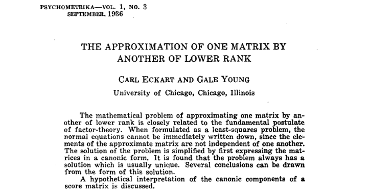

## Temas

1. Motivación
2. Teorema Eckart–Young–Mirsky
3. Ejemplos

**Al final de la segunda clase:** Veremos como surge naturalmente el problema de eigenvalores como solución al problema.

---
## Motivación

<iframe
    src="plano_interactivo.html"
    width="100%"
    height="760"
    style="border: none;">
</iframe>

## Respuesta:

Los puntos fueron generados con la ecuación:
\begin{equation}
\begin{split}
z = 0.75 x - 0.55 y + 0.4 + \epsilon, \quad \epsilon = \mathcal{N}(0,2.2)
\end{split}
\end{equation}
por lo que el ángulo azimutal es:
\begin{equation}
\theta = \mathrm{arctan}(-0.55/0.75) \approx -0.63
\end{equation}
y la altitud es:
\begin{equation}
\phi = \mathrm{arctan}(0.4/\sqrt{(0.55^2 + 0.75^2)}) \approx -0.49
\end{equation}


## Vamos a la mate...

## El problema:
Sea un punto $x\in\mathbb{R}^{p}$, representamos a un conjunto de puntos $\{x_i\}_{i=1}^{n}$ con una matrix $\mathbf{X}\in \mathbb{R}^{n\times p}$. 


Una representación de los datos con dimensión reducida busca una matrix $\mathbf{B}^*$ con $\mathrm{rank}(\mathbf{X})\leq k, \quad k < \min(n,p)$, tal que

\begin{equation}
\mathbf{B}^* = \mathrm{argmin}_{\mathbf{B}}||\mathbf{X} - \mathbf{B}||
\end{equation}

## Solución
{width="70%" fig-align="center"}

## Teorema de Eckart-Young-Mirsky

Eckart y Young (1936) probaron que la solución para la norma de Frobenius, la solución está dada por lo que más tarde se le llamó como decomposición SDV. Más tarde Mirsky (1960) generalizó la prueva para cualquier norma invariante ante multiplicaciones por matrices unitarias.

## Recordando
La norma de Frobenius es,
\begin{equation}
||\mathbf{X}-\mathbf{B}||_F^2 = \sum_{i=1}^{n}\sum_{j=1}^{p}(x_{ij}-b_{ij})^2.
\end{equation}

### Decomposición SVD:
Toda matrix puede escribirse en su decomposición SVD como $\mathbf{X} = \mathbf{U}\mathbf{\Lambda} \mathbf{V}^T$;
$\mathbf{U}\in \mathbb{R}^{n\times n}$, $\mathbf{V}\in\mathbb{R}^{p\times p}$ ortogonales, e.g. $\mathbf{U}^T\mathbf{U} = \mathbf{I}$, y $\mathbf{\Lambda}\in\mathbb{R}^{n\times p}$ una matris rectangular diagonal con elementos positivos llamados \textbf{componentes principales}.

##
::: {.fragment .fade-in}

**¿Son las matrices $\mathbf{U}$ y $\mathbf{V}$ definidas de forma única?**
 
:::

::: {.fragment .fade-in}
No
:::

::: {.fragment .fade-in}

**¿Y que sucede con $\mathbf{\Lambda}$?**

:::

::: {.fragment .fade-in}
Si, si se define un orden.
:::

::: {.fragment .fade-in}

**¿Cómo calcular la decomposición SVD de una matris?**

:::

::: {.fragment .fade-in}
$\cdots$
:::

::: {.fragment .fade-in}

**¿Cómo se usa la decomposición SVD para approximar la matris?**

:::

##
Eckart y Young, años despues generalizado por Mirsky, mostraron que la aproximación optima esta dada por:
\begin{equation}
\begin{split}
      &\hat{\mathbf{X}} = {\mathbf{U}} \hat{\mathbf{\Psi}}{\mathbf{V}}^T = \hat{\mathbf{U}}_r \hat{\mathbf{\Psi}}_r\hat{\mathbf{V}}_r^T,  \\
      &\mathrm{diag}(\hat{\Psi}) = (\mathbf{\psi_1},\cdots,\mathbf{\psi_r},0,\cdots,0)
\end{split}
\end{equation}
en donde ${\mathbf{U}}_r \in \mathbb{R}^{m\times r}$ es la versión truncada de $\mathbf{U}$, dejando unicamente las primeras $r$ columns.

## Ejemplo
<iframe
    src="svd_interactive_demo.html"
    width="100%"
    height="760"
    style="border: none;">
</iframe>

## Ejemplo 2

$Z = 0.75x - 0.55y + 0.4 + \epsilon$

```{python}
#| echo: true
import numpy as np
import plotly.graph_objects as go
from plotly.subplots import make_subplots

# ============================================================
# 1. Generate data from the original plane equation
# ============================================================

rng = np.random.default_rng(42)

n_points = 100

x = rng.uniform(-10, 10, n_points)
y = rng.uniform(-10, 10, n_points)

z = 0.75 * x - 0.55 * y + 0.4 + rng.normal(0.0, 2.2, n_points)

# Data matrix (NO centering)
X = np.column_stack((x, y, z))

# ============================================================
# 2. Compute SVD
# ============================================================

U, S, Vt = np.linalg.svd(X, full_matrices=False)

# Singular values
print("Singular values:")
print(S)
```

##

```{python}
#| echo: true
# ============================================================
# 3. Rank-k approximations
# ============================================================

def reconstruct(k):
    return U[:, :k] @ np.diag(S[:k]) @ Vt[:k, :]

# Energy captured by each rank-k approximation
total_energy = np.sum(S**2)

energy = np.cumsum(S**2) / total_energy

print("\nEnergy captured:")
for k in range(1, 4):
    print(f"Rank {k}: {energy[k-1]*100:.2f}%")

```

##

```{python}
#| echo: true
# ============================================================
# 4. Compare the right singular vectors with the plane normal
# ============================================================

normal = np.array([0.75, -0.55, -1.0])
normal = normal / np.linalg.norm(normal)

print("\nDot products with plane normal:")
for i in range(3):
    print(f"v{i+1}: {np.dot(Vt[i], normal):.4f}")
```

##

```{python}
#| echo: true
# ============================================================
# 5. Interactive visualization
# ============================================================

fig = make_subplots(
    rows=2,
    cols=3,
    specs=[
        [{"type": "scatter3d"}, {"type": "scatter3d"}, {"type": "scatter3d"}],
        [{"type": "heatmap"}, {"type": "bar"}, {"type": "scatter"}]
    ],
    subplot_titles=[
        "Original data",
        "Rank-1 approximation",
        "Rank-2 approximation",
    ]
)

# Original points
fig.add_trace(
    go.Scatter3d(
        x=X[:, 0], y=X[:, 1], z=X[:, 2],
        mode="markers",
        marker=dict(size=4),
        name="Original"
    ),
    row=1, col=1
)

# Rank-1 approximation
X1 = reconstruct(1)

fig.add_trace(
    go.Scatter3d(
        x=X1[:, 0], y=X1[:, 1], z=X1[:, 2],
        mode="markers",
        marker=dict(size=4),
        name="Rank 1"
    ),
    row=1, col=2
)

# Rank-2 approximation
X2 = reconstruct(2)

fig.add_trace(
    go.Scatter3d(
        x=X2[:, 0], y=X2[:, 1], z=X2[:, 2],
        mode="markers",
        marker=dict(size=4),
        name="Rank 2"
    ),
    row=1, col=3
)


fig.update_layout(
    height=900,
    showlegend=False
)

fig.show()

```

# ¿Preguntas por el momento?