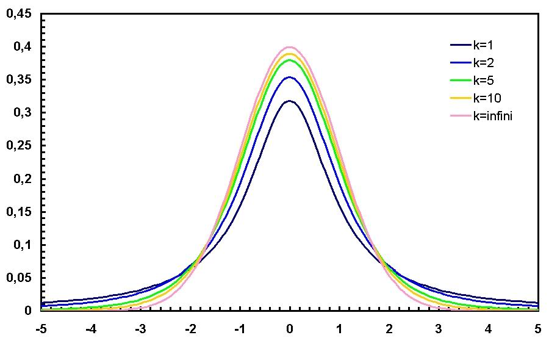

## ¿Dónde estamos?

Hasta ahora hemos estudiado métodos **no supervisados**:

- PCA busca direcciones que resumen la variabilidad de $X$.
- No necesita una variable objetivo ni etiquetas.

Ahora empezamos con **aprendizaje supervisado**:

- Tenemos variables de entrada $X$ y una respuesta conocida $y$.
- Buscamos aprender una función que relacione ambas.


---

## Objetivos de esta sesión

1. Entender la idea de regresión como problema supervisado.
2. Formular el modelo lineal simple y el modelo lineal múltiple.
3. Estimar parámetros mediante mínimos cuadrados.
4. Interpretar coeficientes y cuantificar incertidumbre.
5. Evaluar ajuste y capacidad predictiva.
6. Reconocer supuestos y limitaciones del modelo.

**Pregunta guía:** ¿qué significa decir que una variable está asociada linealmente con otra?

---

## Un ejemplo: predecir una respuesta

Imaginemos que queremos predecir el consumo eléctrico de una casa usando su temperatura exterior.

- Variable explicativa o predictor: temperatura $x$.
- Variable respuesta u objetivo: consumo $y$.
- Observamos pares $(x_i,y_i)$ para $i=1,\ldots,n$.

El objetivo es encontrar una regla que aproxime la relación entre temperatura y consumo.

La palabra *supervisado* significa que, durante el entrenamiento, conocemos tanto los predictores como las respuestas observadas.

---

## Regresión lineal simple

El modelo lineal simple se escribe:

$$
\boxed{y_i=\beta_0+\beta_1x_i+\varepsilon_i}
$$

donde:

- $\beta_0$: intercepto.
- $\beta_1$: pendiente.
- $\varepsilon_i$: error aleatorio no observado.

##
La respuesta media condicionada a $x_i$ se modela como

$$
\mathbb{E}[Y_i\mid X_i=x_i]=\beta_0+\beta_1x_i.
$$

**Importante:** los puntos observados no tienen que caer exactamente sobre la recta. El modelo describe una tendencia media y admite variabilidad alrededor de ella.

---

## Visualizar el modelo

La recta representa la respuesta predicha; las distancias verticales entre observaciones y recta son los residuos.

```{python}
import numpy as np
import matplotlib.pyplot as plt

rng = np.random.default_rng(7)
x = np.linspace(0, 10, 35)
y = 4 + 2.2*x + rng.normal(0, 3.0, size=len(x))

fig, ax = plt.subplots(figsize=(7, 4.5))
ax.scatter(x, y, label="Datos observados")
ax.plot(x, 4 + 2.2*x, color="tab:red", label="Relación media")
ax.set_xlabel("Temperatura (ejemplo)")
ax.set_ylabel("Consumo (ejemplo)")
ax.set_title("Una relación aproximadamente lineal")
ax.legend()
plt.show()
```

---

## ¿Qué queremos decir con «mejor recta»?

Para cada observación, la predicción es

$$
\hat{y}_i=\hat{\beta}_0+\hat{\beta}_1x_i.
$$

El residuo es la diferencia entre lo observado y lo predicho:

$$
e_i=y_i-\hat{y}_i.
$$

##
Mínimos cuadrados elige los coeficientes que minimizan la suma de residuos al cuadrado:
	
$$
\boxed{
\min_{\beta_0,\beta_1}
\sum_{i=1}^{n}
(y_i-\beta_0-\beta_1x_i)^2
}
$$


---

## Solución en el caso simple

Si la variación de $x$ no es cero, las estimaciones OLS son

$$
\hat{\beta}_1=
\frac{\sum_i(x_i-\bar{x})(y_i-\bar{y})}
{\sum_i(x_i-\bar{x})^2},
\qquad
\hat{\beta}_0=\bar{y}-\hat{\beta}_1\bar{x}.
$$

##
La pendiente también puede escribirse como

$$
\hat{\beta}_1=\frac{\operatorname{Cov}(X,Y)}
{\operatorname{Var}(X)}
$$

usando la misma convención de divisor en covarianza y varianza.

Esto conecta regresión lineal con conceptos que ya vimos: media, varianza y covarianza.

---

## Ajustar una recta en Python

```{python}
#| echo: true
# Ajuste OLS con fórmulas explícitas
x_bar = x.mean()
y_bar = y.mean()

beta1_hat = np.sum((x - x_bar)*(y - y_bar)) / np.sum((x - x_bar)**2)
beta0_hat = y_bar - beta1_hat*x_bar

y_hat = beta0_hat + beta1_hat*x
residuals = y - y_hat

print(f"Intercepto estimado: {beta0_hat:.3f}")
print(f"Pendiente estimada:  {beta1_hat:.3f}")
print(f"Primeros residuos:   {np.round(residuals[:5], 2)}")
```

```{python}
fig, ax = plt.subplots(figsize=(7, 4.5))
ax.scatter(x, y, label="Observaciones")
ax.plot(x, y_hat, color="tab:red", label="Recta OLS")
for xi, yi, ypi in zip(x[::4], y[::4], y_hat[::4]):
    ax.plot([xi, xi], [yi, ypi], color="gray", alpha=0.7, lw=1)
ax.set_xlabel("x")
ax.set_ylabel("y")
ax.set_title("Predicciones y residuos")
ax.legend()
plt.show()
```

---
## De una a varias variables explicativas

En muchos problemas, una respuesta depende de más de un predictor.

Por ejemplo, el precio de una vivienda puede estar asociado con:

- Área en metros cuadrados.
- Número de habitaciones.
- Antigüedad.
- Distancia al centro.

##
El modelo lineal múltiple es

$$
\boxed{
y_i=\beta_0+\beta_1x_{i1}+\cdots+\beta_px_{ip}+\varepsilon_i
}
$$

Hay una respuesta $y$ y $p$ variables explicativas.

---

## Interpretar la regresión múltiple

En el modelo

$$
\mathbb{E}[Y\mid X_1,\ldots,X_p]
=\beta_0+\beta_1X_1+\cdots+\beta_pX_p,
$$

el coeficiente $\beta_j$ representa el cambio esperado en $Y$ asociado con aumentar $X_j$ una unidad, **manteniendo constantes los demás predictores**.


---

## Formulación matricial

La regresión múltiple se expresa de forma compacta:

$$
\boxed{\mathbf{y}=\mathbf{X}\boldsymbol{\beta}+\boldsymbol{\varepsilon}}
$$

Con intercepto, la primera columna de $\mathbf{X}$ es un vector de unos.

Dimensiones:

- $\mathbf{y}\in\mathbb{R}^{n\times 1}$.
- $\mathbf{X}\in\mathbb{R}^{n\times(p+1)}$.
- $\boldsymbol{\beta}\in\mathbb{R}^{(p+1)\times 1}$.
- $\boldsymbol{\varepsilon}\in\mathbb{R}^{n\times 1}$.

##
El objetivo es minimizar encontrar

$$
\mathbf{y}^* = \mathrm{argmin}_{\mathbf{y}}\|\mathbf{y}-\mathbf{X}\boldsymbol{\beta}\|_2^2.
$$

---

## La solución de mínimos cuadrados

Si las columnas de $\mathbf{X}$ son linealmente independientes, la solución es

$$
\boxed{
\hat{\boldsymbol{\beta}}
=(\mathbf{X}^T\mathbf{X})^{-1}\mathbf{X}^T\mathbf{y}.
}
$$

La matriz $\mathbf{X}^T\mathbf{X}$ debe ser invertible para usar esta expresión.

En la práctica, es preferible resolver el problema con métodos numéricos estables (como SVD) en vez de calcular explícitamente la inversa.

## Ejemplo de regresión múltiple en Python


```{python}
#| echo: true
rng = np.random.default_rng(21)
n = 120

area = rng.normal(100, 20, n)       # metros cuadrados
age = rng.uniform(0, 40, n)         # años
noise = rng.normal(0, 12, n)

price = 35 + 2.8*area - 0.7*age + noise

X = np.column_stack([area, age])
X_design = np.column_stack([np.ones(n), X])

beta_hat, *_ = np.linalg.lstsq(X_design, price, rcond=None)
price_hat = X_design @ beta_hat

print("Coeficientes [intercepto, área, antigüedad]:")
print(np.round(beta_hat, 3))
```

En este ejemplo, los coeficientes se interpretan en las unidades que definimos para precio, área y antigüedad.

---

## Evaluar el ajuste: suma de cuadrados

Definimos la suma total de cuadrados:

$$
\mathrm{SST}=\sum_i(y_i-\bar{y})^2 = \mathrm{SSR}+\mathrm{SSE},
$$

Minimos cuadrados descompone la variabilidad, donde $\mathrm{SSR}=\sum_i(\hat{y}_i-\bar{y})^2$ es la suma de cuadrados explicada y $\mathrm{SSE}=\sum_i(y_i-\hat{y}_i)^2$ es la suma de cuadrados residual.

---

## Coeficiente de determinación: $R^2$

Una medida habitual del ajuste es

$$
\boxed{
R^2=1-\frac{\mathrm{SSE}}{\mathrm{SST}}.
}
$$

$R^2$ mide la fracción de la variabilidad observada de $y$ que queda explicada por las predicciones del modelo en esos datos (En el caso particular de una regresión lineal, R2 coincide con el cuadrado del coeficiente de correlación de Pearson).

---

## Calcular métricas de ajuste

```{python}
#| echo: true
resid = price - price_hat
sst = np.sum((price - price.mean())**2)
sse = np.sum(resid**2)
r2 = 1 - sse/sst
rmse = np.sqrt(np.mean(resid**2))
mae = np.mean(np.abs(resid))

print(f"R² en los datos de entrenamiento: {r2:.3f}")
print(f"RMSE: {rmse:.3f}")
print(f"MAE:  {mae:.3f}")
```

- **RMSE:** penaliza más los errores grandes y conserva las unidades de $y$.
- **MAE:** promedio del error absoluto, también en unidades de $y$.
- Estas métricas calculadas en entrenamiento no estiman por sí solas el desempeño fuera de muestra.

---

## $R^2$ ajustado

Al agregar predictores, el $R^2$ de entrenamiento nunca disminuye, incluso si la nueva variable aporta muy poco.

El $R^2$ ajustado penaliza el número de predictores:

$$
\boxed{
R^2_{\mathrm{aj}}
=1-(1-R^2)\frac{n-1}{n-p-1}
}
$$

donde $n$ es el número de observaciones y $p$ el número de predictores (sin contar el intercepto).

No reemplaza la evaluación en datos de prueba, pero ayuda a comparar modelos con distinto número de variables.

---

## Separar entrenamiento y prueba

Para evaluar predicción, no debemos medir únicamente sobre los datos usados para ajustar el modelo.

1. Dividimos los datos en entrenamiento y prueba.
2. Ajustamos los coeficientes usando entrenamiento.
3. Predecimos las respuestas del conjunto de prueba.
4. Calculamos métricas en datos no usados para ajustar.

```{python}
from sklearn.model_selection import train_test_split
from sklearn.linear_model import LinearRegression
from sklearn.metrics import mean_squared_error, mean_absolute_error, r2_score

X_train, X_test, y_train, y_test = train_test_split(
    X, price, test_size=0.25, random_state=42
)

model = LinearRegression()
model.fit(X_train, y_train)

pred_test = model.predict(X_test)

print("Intercepto:", round(model.intercept_, 3))
print("Coeficientes:", np.round(model.coef_, 3))
print("R² prueba:", round(r2_score(y_test, pred_test), 3))
print("RMSE prueba:", round(np.sqrt(mean_squared_error(y_test, pred_test)), 3))
print("MAE prueba:", round(mean_absolute_error(y_test, pred_test), 3))
```

---

## Inferencia: ¿qué tan inciertos son los coeficientes?

Hasta ahora usamos regresión para estimar y predecir. La estadística también permite cuantificar incertidumbre.

Bajo ciertos supuestos, podemos estudiar:

- Errores estándar de los coeficientes.
- Intervalos de confianza.
- Pruebas de hipótesis sobre coeficientes.

##

Por ejemplo, para un predictor $X_j$ podemos plantear:

$$
H_0:\beta_j=0
\qquad\text{vs.}\qquad
H_1:\beta_j\neq 0.
$$

La pregunta es si los datos aportan evidencia de una asociación lineal parcial distinta de cero, bajo el modelo y sus supuestos.

---

## Supuestos clásicos del modelo lineal

Para la interpretación e inferencia clásica de minimos cuadrados, suelen considerarse:

1. **Linealidad en los parámetros:** el valor esperado de $Y$ se expresa como una combinación lineal de los coeficientes.
2. **Exogeneidad:** $\mathbb{E}[\varepsilon\mid X]=0$.
3. **Ausencia de colinealidad perfecta:** ningún predictor es combinación lineal exacta de los demás.
4. **Errores no correlacionados entre observaciones** (en el caso clásico).

##
5. **Homoscedasticidad:** varianza del error constante, $\operatorname{Var}(\varepsilon\mid X)=\sigma^2$.

La normalidad de los errores es un supuesto adicional usado para la inferencia exacta en muestras pequeñas..


## Diagnóstico visual de residuos

Los residuos ayudan a detectar patrones que el modelo no está capturando.

```{python}
fig, axes = plt.subplots(1, 2, figsize=(10, 4))

axes[0].scatter(price_hat, resid, alpha=0.75)
axes[0].axhline(0, color="tab:red", linestyle="--")
axes[0].set_xlabel("Valores ajustados")
axes[0].set_ylabel("Residuos")
axes[0].set_title("Residuos vs. ajustados")

axes[1].hist(resid, bins=18, edgecolor="white")
axes[1].set_xlabel("Residuo")
axes[1].set_ylabel("Frecuencia")
axes[1].set_title("Distribución de residuos")

plt.tight_layout()
plt.show()
```
##

Idealmente, el gráfico de residuos no muestra patrones sistemáticos ni cambios evidentes en su dispersión. Un histograma ayuda a inspeccionar la forma de la distribución, pero no prueba normalidad.

## t Student statistic

Si $\mathbf{SE}_k$ es la desviación estandar del valor estimado para $\beta_k$, entonces $(\hat{\beta}-\beta_0) / (\mathbf{SE}_k)$ sigue la distribución de t Student con n-2 grados de libertad.

{width="70%" fig-align="center"}

# Preguntas