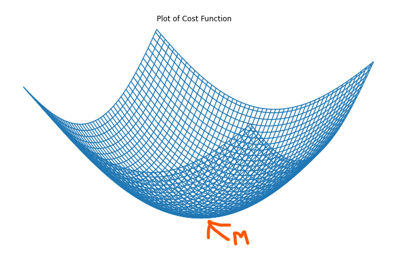

We ask first whether we need a theory of creative thinking distinct from a theory of problem solving. Subject to minor qualifications, we conclude there is no such need - that we call problem solving creative when the problems solved are relatively new and difficult. Next, we summarize what has been learned about problem solving by simulating certain human problem solving processes with digital computers. (**Newell, A., Shaw, J. C., & Simon, H. A. (1962). The processes of creative thinking**).

##

The first AI winter started in the 1970s, due to unfulfilled promises, vast expectations, and financial difficulties.
At the same time, AI encountered impossible-to-overcome technological barriers, mainly on the limitations of
computing power, memory, and processing speed. In the mid-1960s, researchers discovered a distinction
between polynomial and exponential growth in problem complexity (**...**)

##
In the 1980s, the AI paradigm shifted to symbolic AI and the so-called “expert systems” or “knowledge-based systems.” The underlying idea was to get human expert knowledge in a computer form and spread it as a
program to many Personal Computers  (**Delipetrev, B., Tsinaraki, C., & Kostic, U. (2020). Historical evolution of artificial intelligence**).

##

BP’s continuous form was derived in the early 1960s (**...**) Wan (1994) produced the first BP-trained NN to win a controlled pattern recognition contest with secret test set. (**...**) In the 2000s, computing hardware had again become 10,000 times faster per cent than in the 1980s. Cheap massively parallel Graphics Processing Units (GPUs, originally developed for video games) started to revolutionise NN research (**Schmidhuber, J. (2015). Deep learning. Scholarpedia, 10(11), 32832 **).

## Recapitulación

Asta el momento hemos visto dos métodos,

- **PCA:** Un método no supervisado

- **Regresion Lineal:** Un método supervisado.

Pero, ¿es eso machine learning?

## ¿Cómo encontraríamos el mínimo de una función?

Comutación tradicional (El método que describimos los días anteriores) buscaría resolver una equaciónn del tipo:
 $$\frac{d f(x)}{dx} = 0$$

Ejemplo, PCA encuentra la solución exacta para transformaciónes lineales al encontrar la dirección que maximisa la varianza.

## Y si no podemos resolver estas ecuación?
 
**¿Cómo encontraríamos el punto más bajo de una pendiente nosotros?** 

{width="100%" fig-align="center"}

## Reformulando PCA con el paradigma de ML

PCA busca encontrar $\mathbf{w}^*$ tal que:

$$
\mathbf{w}^* = \mathrm{argmin}_{\mathbf{w}} \mathcal{L}(\mathbf{w},\lambda), \quad \mathcal{L}(\mathbf{w},\lambda)
=\mathbf{w}^T\mathbf{S}\mathbf{w}
-\lambda(\mathbf{w}^T\mathbf{w}-1).
$$

Pero en lugar de resolverlo con nuestro expertise, dejemos a la computadora "Aprender" la solución.

## Deciente del gradiente

$$
\begin{array}{ll}
1: & t \leftarrow 0\\
2: & \textbf{while } t < T \textbf{ do}\\
3: & \quad g_t \leftarrow \nabla f(\theta_t)\\
4: & \quad \textbf{if } \|g_t\| < \epsilon \textbf{ then}\\
5: & \qquad \textbf{break}\\
6: & \quad \textbf{end if}\\
7: & \quad \theta_{t+1} \leftarrow \theta_t - \alpha g_t\\
8: & \quad t \leftarrow t+1\\
9: & \textbf{end while}\\
\end{array}
$$

##

```{python}

import numpy as np
import matplotlib.pyplot as plt

from mpl_toolkits.mplot3d import Axes3D

# ==========================================
# 1. Definición de la función de Himmelblau
# ==========================================

def f(x, y):
    return ((x**2 + y - 11)**2 + (x + y**2 - 7)**2 +1)* ((x+2)**2+(y-3)**2)

def gradient(x, y):
    df_dx = (4*x*(x**2 + y - 11) + 2*(x + y**2 - 7))* ((x+2)**2+(y-3)**2) + ((x**2 + y - 11)**2 + (x + y**2 - 7)**2 +1)*2*(x+2)
    df_dy = (2*(x**2 + y - 11) + 4*y*(x + y**2 - 7))* ((x+2)**2+(y-3)**2) + ((x**2 + y - 11)**2 + (x + y**2 - 7)**2 +1) * 2*(y-3)
    return np.array([df_dx, df_dy])
    


# ==========================================
# 2. Gradient Descent
# ==========================================

learning_rate = 0.001
iterations = 1000

# Punto inicial
point = np.array([-4.0, 4.0])

trajectory = [point.copy()]

for i in range(iterations):
    grad = gradient(point[0], point[1])
    point = point - learning_rate * grad
    trajectory.append(point.copy())

trajectory = np.array(trajectory)

# ==========================================
# 3. Crear la superficie
# ==========================================

x = np.linspace(-5, 5, 200)
y = np.linspace(-5, 5, 200)

X, Y = np.meshgrid(x, y)
Z = f(X, Y)

# Valores de la trayectoria
Z_path = f(trajectory[:, 0], trajectory[:, 1])

# ==========================================
# 4. Visualización
# ==========================================

fig = plt.figure(figsize=(16, 7))

# ----- Superficie 3D -----
ax1 = fig.add_subplot(121, projection='3d')

ax1.plot_surface(
    X, Y, Z,
    cmap='viridis',
    alpha=0.85,
    linewidth=0,
    antialiased=True
)

# Trayectoria sobre la superficie
ax1.plot(
    trajectory[:, 0],
    trajectory[:, 1],
    Z_path,
    color='red',
    linewidth=3,
    label='Gradient Descent'
)

# Punto inicial
ax1.scatter(
    trajectory[0, 0],
    trajectory[0, 1],
    Z_path[0],
    color='orange',
    s=100,
    label='Inicio'
)

# Punto final
ax1.scatter(
    trajectory[-1, 0],
    trajectory[-1, 1],
    Z_path[-1],
    color='red',
    s=100,
    label='Mínimo'
)

ax1.set_title('Superficie de la función')
ax1.set_xlabel('x')
ax1.set_ylabel('y')
ax1.set_zlabel('f(x,y)')
ax1.legend()

# ----- Curvas de nivel -----
ax2 = fig.add_subplot(122)

contours = ax2.contour(
    X, Y, Z,
    levels=np.logspace(-1, 3, 30),
    cmap='viridis'
)

ax2.clabel(contours, inline=True, fontsize=7)

# Trayectoria
ax2.plot(
    trajectory[:, 0],
    trajectory[:, 1],
    color='red',
    linewidth=2,
    label='Gradient Descent'
)

# Puntos
ax2.scatter(
    trajectory[0, 0],
    trajectory[0, 1],
    color='orange',
    s=100,
    label='Inicio',
    zorder=5
)

ax2.scatter(
    trajectory[-1, 0],
    trajectory[-1, 1],
    color='red',
    s=100,
    label='Mínimo',
    zorder=5
)

ax2.set_title('Curvas de nivel y trayectoria')
ax2.set_xlabel('x')
ax2.set_ylabel('y')
ax2.legend()
ax2.grid(alpha=0.2)

plt.tight_layout()
plt.show()
```

## Deciente del gradiente estocastico

```{python}
import numpy as np
import matplotlib.pyplot as plt

# ==========================================
# 1. Himmelblau function
# ==========================================

def f(x, y):
    return ((x**2 + y - 11)**2 + (x + y**2 - 7)**2 +1)* ((x+2)**2+(y-3)**2)

def gradient(x, y):
    dx = (4*x*(x**2 + y - 11) + 2*(x + y**2 - 7))* ((x+2)**2+(y-3)**2) + ((x**2 + y - 11)**2 + (x + y**2 - 7)**2 +1)*2*(x+2)
    dy = (2*(x**2 + y - 11) + 4*y*(x + y**2 - 7))* ((x+2)**2+(y-3)**2) + ((x**2 + y - 11)**2 + (x + y**2 - 7)**2 +1) * 2*(y-3)
    return np.array([dx, dy])


# ==========================================
# 2. Stochastic Gradient Descent
# ==========================================

np.random.seed(52)

learning_rate = 0.001
iterations = 1000
noise_level = 50.0

point = np.array([-4.0, 4.0])
trajectory = [point.copy()]

for t in range(iterations):

    grad = gradient(*point)

    # Strong stochastic noise
    noise = np.random.normal(
        loc=0,
        scale=noise_level,
        size=2
    )

    stochastic_grad = grad + noise

    # SGD update
    point = point - learning_rate * stochastic_grad

    trajectory.append(point.copy())

trajectory = np.array(trajectory)
Z_path = f(trajectory[:, 0], trajectory[:, 1])


# ==========================================
# 3. Surface
# ==========================================

x = np.linspace(-5, 5, 200)
y = np.linspace(-5, 5, 200)

X, Y = np.meshgrid(x, y)
Z = f(X, Y)


# ==========================================
# 4. Visualization
# ==========================================

fig = plt.figure(figsize=(16, 7))

# -------- 3D Surface --------

ax1 = fig.add_subplot(121, projection='3d')

ax1.plot_surface(
    X, Y, Z,
    cmap='viridis',
    alpha=0.85,
    linewidth=0
)

ax1.plot(
    trajectory[:, 0],
    trajectory[:, 1],
    Z_path,
    color='red',
    linewidth=1.0,
    alpha=0.85,
    label='SGD trajectory'
)

ax1.scatter(
    *trajectory[0],
    Z_path[0],
    color='orange',
    s=100,
    label='Start'
)

ax1.scatter(
    *trajectory[-1],
    Z_path[-1],
    color='red',
    s=100,
    label='Final point'
)

ax1.set_title('Stochastic Gradient Descent')
ax1.set_xlabel('x')
ax1.set_ylabel('y')
ax1.set_zlabel('f(x,y)')
ax1.legend()


# -------- Contour Plot --------

ax2 = fig.add_subplot(122)

contours = ax2.contour(
    X, Y, Z,
    levels=np.logspace(-1, 3, 35),
    cmap='viridis'
)

ax2.clabel(contours, inline=True, fontsize=7)

ax2.plot(
    trajectory[:, 0],
    trajectory[:, 1],
    color='red',
    linewidth=0.8,
    alpha=0.7,
    label='SGD trajectory'
)

ax2.scatter(
    *trajectory[0],
    color='orange',
    s=100,
    label='Start',
    zorder=5
)

ax2.scatter(
    *trajectory[-1],
    color='blue',
    s=100,
    label='Final point',
    zorder=5
)

ax2.set_title('Contour Plot - Stochastic Optimization')
ax2.set_xlabel('x')
ax2.set_ylabel('y')
ax2.set_xlim(-5,0)
ax2.set_ylim(0,5)
ax2.legend()
ax2.grid(alpha=0.2)


plt.tight_layout()
plt.show()
```
## Decente del gradiente con momento

```{python}

import numpy as np
import matplotlib.pyplot as plt

from mpl_toolkits.mplot3d import Axes3D

# ==========================================
# 1. Definición de la función de Himmelblau
# ==========================================

def f(x, y):
    return ((x**2 + y - 11)**2 + (x + y**2 - 7)**2 +1)* ((x+2)**2+(y-3)**2)

def gradient(x, y):
    df_dx = (4*x*(x**2 + y - 11) + 2*(x + y**2 - 7))* ((x+2)**2+(y-3)**2) + ((x**2 + y - 11)**2 + (x + y**2 - 7)**2 +1)*2*(x+2)
    df_dy = (2*(x**2 + y - 11) + 4*y*(x + y**2 - 7))* ((x+2)**2+(y-3)**2) + ((x**2 + y - 11)**2 + (x + y**2 - 7)**2 +1) * 2*(y-3)
    return np.array([df_dx, df_dy])
    


# ==========================================
# 2. Gradient Descent
# ==========================================

learning_rate = 0.001
iterations = 1000

# Punto inicial
point = np.array([-4.0, 4.0])

trajectory = [point.copy()]
v=0
beta = 0.5
for i in range(iterations):
    grad = gradient(point[0], point[1])
    v = learning_rate*grad + beta*v
    point = point - v
    trajectory.append(point.copy())

trajectory = np.array(trajectory)

# ==========================================
# 3. Crear la superficie
# ==========================================

x = np.linspace(-5, 5, 200)
y = np.linspace(-5, 5, 200)

X, Y = np.meshgrid(x, y)
Z = f(X, Y)

# Valores de la trayectoria
Z_path = f(trajectory[:, 0], trajectory[:, 1])

# ==========================================
# 4. Visualización
# ==========================================

fig = plt.figure(figsize=(16, 7))

# ----- Superficie 3D -----
ax1 = fig.add_subplot(121, projection='3d')

ax1.plot_surface(
    X, Y, Z,
    cmap='viridis',
    alpha=0.85,
    linewidth=0,
    antialiased=True
)

# Trayectoria sobre la superficie
ax1.plot(
    trajectory[:, 0],
    trajectory[:, 1],
    Z_path,
    color='red',
    linewidth=3,
    label='Gradient Descent'
)

# Punto inicial
ax1.scatter(
    trajectory[0, 0],
    trajectory[0, 1],
    Z_path[0],
    color='orange',
    s=100,
    label='Inicio'
)

# Punto final
ax1.scatter(
    trajectory[-1, 0],
    trajectory[-1, 1],
    Z_path[-1],
    color='red',
    s=100,
    label='Mínimo'
)

ax1.set_title('Superficie de la función')
ax1.set_xlabel('x')
ax1.set_ylabel('y')
ax1.set_zlabel('f(x,y)')
ax1.legend()

# ----- Curvas de nivel -----
ax2 = fig.add_subplot(122)

contours = ax2.contour(
    X, Y, Z,
    levels=np.logspace(-1, 3, 30),
    cmap='viridis'
)

ax2.clabel(contours, inline=True, fontsize=7)

# Trayectoria
ax2.plot(
    trajectory[:, 0],
    trajectory[:, 1],
    color='red',
    linewidth=2,
    label='Gradient Descent'
)

# Puntos
ax2.scatter(
    trajectory[0, 0],
    trajectory[0, 1],
    color='orange',
    s=100,
    label='Inicio',
    zorder=5
)

ax2.scatter(
    trajectory[-1, 0],
    trajectory[-1, 1],
    color='red',
    s=100,
    label='Mínimo',
    zorder=5
)

ax2.set_title('Curvas de nivel y trayectoria')
ax2.set_xlabel('x')
ax2.set_ylabel('y')
ax2.set_xlim(-5,0)
ax2.set_ylim(0,5)
ax2.legend()
ax2.grid(alpha=0.2)

plt.tight_layout()
plt.show()
```

## ¿Que algorithmo usar?

- En problemas más complicados (NN training, Deep learning, etc), es preferible métodos que no encuentran el mínimo global, sino minimos buenos para generalización.

- Es estandar buscar métodos con estocasticidad. Generalmente se obtiene al usar subconjuntos de datos para calcular el gradiente en lugar de todos los datos al entrenar.

- También métodos que combinan la estocasticidad con momento.

- Un algoritmo antiguo pero que sigue siendo usado asta hoy es Adam, por su capacidad de adaptarse a muchos problemas.


# Preguntas